<div align="center">
  
</div>

<br>

## ⭐ Proyectos destacados

### 🚲 BikeMaint

**Cada pieza de tu bici, con su vida útil.** Marca cuántos km o días toca revisarla y te avisa antes de que falle. Web propia, en beta privada, con el backend en mi Raspberry Pi.

<div align="center">
  
  <br><br>
  <a href="https://bike-maint.com"></a>
</div>

### 🖥️ Notchpad

**Tu notch, ahora útil.** Un panel para macOS que se abre al pasar el ratón: música, tiempo, apps, bandeja de archivos y estado del Mac. Gratis, de código abierto y sin telemetría.

<div align="center">
  
  <br><br>
  
</div>

## 🔧 En el taller

<table>
  <tr>
    <td width="50%" valign="top">
      <b>🌡️ Clima con Arduino</b><br>
      Mide temperatura y humedad, regula el clima y se enciende o apaga desde Telegram.
    </td>
    <td width="50%" valign="top">
      <b>🍓 Homelab</b><br>
      Raspberry Pi con mis webs, el backend de BikeMaint y OctoPrint.
    </td>
  </tr>
  <tr>
    <td width="50%" valign="top">
      <b>🖨️ Impresoras 3D</b><br>
      Controladas en remoto con OctoPrint.
    </td>
    <td width="50%" valign="top">
      <b>🧩 <a href="https://github.com/daanidev21/claude-mods">claude-mods</a></b><br>
      Mods para Claude Code, en TypeScript. Mi único repo público por ahora.
    </td>
  </tr>
</table>

## 🧬 Mi stack

```text
~/stack
├── código     JavaScript · TypeScript · Swift · Python · Bash · C++
├── hardware   Arduino · Raspberry Pi · impresión 3D
├── infra      Linux · nginx · Cloudflare · Tailscale · Firebase · OctoPrint · self-hosting
└── ia         LLMs · agentes · automatización
```


